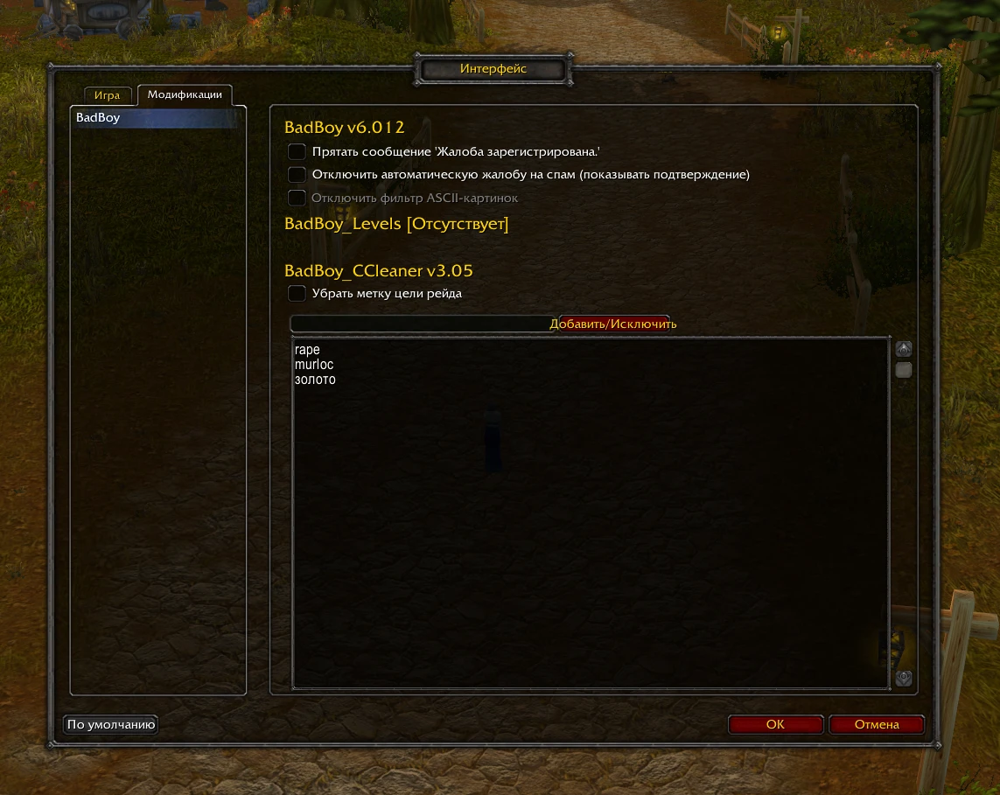

Это плагин для BadBoy: https://sirus.su/base/addons/BadBoy  
Этот плагин не сообщает игрокам, когда чат удален, он просто скрывает его.

Особенности:  
Удаляет строки чата при обнаружении определенного слова.

**Скриншоты:**

